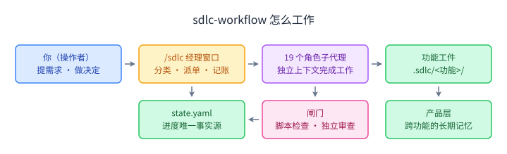

# sdlc-workflow

多宿主软件交付工作流插件 · v4.7.3 · MIT

把需求澄清、设计、实现、验证和交付组织成有范围、有证据、可恢复的工作。既可以完成一个功能，也可以只打磨需求、确认原型、定位问题或修复缺陷。经理会话选择任务并派单，专业角色产出工件，脚本检查与独立审查核验结果。

当前仓库登记 **5 个宿主适配、9 个入口、27 个技能、19 个角色、68 个任务合同**。版本与宿主设置以 [adapters/hosts.json](adapters/hosts.json) 为准，任务与权限以 [workflow/registry.json](workflow/registry.json) 为准。

## 从哪里开始

| 你的目的 | 入口 |
|---|---|
| 第一次使用，了解操作和结果 | [使用指南](docs/usage.md) |
| 安装并接入项目 | [安装与接入](#安装与接入) |
| 找一个命令或任务 | [日常入口](#日常入口)、[角色任务速查](skills/sdlc/references/role-agents.md) |
| 理解阶段、职能和宿主差异 | [阶段合同](skills/sdlc/references/stage-map.md)、[职能视图](skills/sdlc/references/function-map.md)、[宿主路由](skills/sdlc/references/hosts.md) |
| 修改插件本身 | [维护者指南](maintainers/README.md)、[角色源文件](agent-sources/profiles/README.md) |
| 核对上游来源与安装状态 | [vendor 说明](vendor/README.md) |

## 能做什么

- **需求共创**：从具体经历、例子、草图和按需调研开始，区分事实、假设与决定；复用已经明确的需求和授权。
- **按目标交付**：记录项目画像与 `delivery_goal`，可以停在方案交接、本地验证、发布就绪或实际部署。
- **设计与工程衔接**：会影响范围的技术可行性提前检查；最终原型先于架构合同，前端移植已验收的原型代码，按用户旅程切片并在真实后端联调。
- **验证与验收**：QA 做测试和覆盖矩阵，PM、设计、增长分别验收；独立 reviewer 只读审查，QC 给有范围的放行意见，SRE 在授权后发布。
- **持续工作**：同一项目的需求打磨、开发、诊断和数据作业可以按依赖推进，记录工件版本、影响范围、隔离工作区与任务认领。
- **产品记忆**：长期策略、设计系统、架构、领域模型与指标保存在产品层；功能任务和产品周期持续回写。

### 先约定做到哪里

| `delivery_goal` | 完成目标 |
|---|---|
| `proposal_ready` | 已确认的方案及交接材料 |
| `local_verified` | 经过验证和验收的本地构建 |
| `release_ready` | 发布准备与有范围的 QC 放行意见 |
| `deployed` | 获授权后实际完成发布 |

任务按 L0–L4 风险泳道选择流程重量。局部工作记录实际完成的任务与未做的阶段；不会因文档齐全而把未执行的测试或发布算作完成。



完整功能的常见顺序为：发现与澄清 → define → shape → implement → verify / accept → review → qc / deliver → retro。各阶段的任务、条件分支和工件路径见[阶段合同](skills/sdlc/references/stage-map.md)。

## 安装与接入

### 引用同一份插件目录


同一份技能和角色源适配五个宿主，依赖 bash 与 python3。先克隆本仓库并运行 `bash vendor/install.sh` 拉上游原件，自检 `bash scripts/health-check.sh` 应通过。下文 `<PLUGIN_ROOT>` 指插件目录（或指向它的符号链接）。Claude、Grok、Codex、Kimi 优先使用项目级引用，用户级没有 SDLC 链接属于正常的项目隔离。

**所有宿主只能引用这一份目录，不许复制。** 会复制插件的命令一律不用：`claude plugin install`（写缓存副本）、`grok plugin install`（留哈希副本）、`codex plugin add`（装副本且丢弃符号链接）、Kimi `/plugins install`（用户级 managed 副本）。副本会和源头悄悄分叉。

| 宿主 | 引用方式 | 命令 | 角色子代理 |
|---|---|---|---|
| ZCode | 插件目录本身就是 `~/.zcode/local-plugins/sdlc-workflow`（克隆或链接），在 ZCode 中启用（读 `.zcode-plugin/`） | `/sdlc` 等 9 个 | 原生 `sdlc-workflow:<角色>` |
| Claude Code | 只改设置：`extraKnownMarketplaces` 登记 `directory` 源 `<PLUGIN_ROOT>`（项目设置可用相对路径，用户设置用绝对路径），`enabledPlugins` 打开 `sdlc-workflow@sdlc-workflow`；原地加载，不执行 install | `/sdlc` 等（重名时 `/sdlc-workflow:sdlc`） | 原生，清单显式列出 19 个 |
| Grok | 符号链接：受信任项目的 `.grok/plugins/sdlc-workflow`（并在 `.grok/config.toml` 的 `[plugins].enabled` 列出），或 `~/.grok/plugins/sdlc-workflow`；也可用 `[plugins].paths`（读 `.grok-plugin/`） | `/sdlc` 等 | 原生 `sdlc-workflow:<角色>` |
| Codex | `python3 <PLUGIN_ROOT>/scripts/link-codex.py --project <项目根>`：`<项目根>/.codex/skills/sdlc-workflow` 链到 `skills/`，角色 TOML 链进 `<项目根>/.codex/agents/`，只在该项目生效（与 `.claude/` 一样）；不带 `--project` 则使用 `$CODEX_HOME`（默认 `~/.codex/`），所有项目共用；`--check` 核对、`--remove` 撤销 | 无插件命令：用 `$` 或 `/skills` 选 `sdlc-workflow:sdlc`，在请求里写 `mode: product` 等，对照表见 [hosts.md](skills/sdlc/references/hosts.md) | 支持 `agent_type` 的运行时可选 `sdlc-workflow-<角色>`；仅有 `task_name/message` 的运行时走角色提示词回退，审查须先确认有效只读父会话 |
| Kimi Code | `python3 <PLUGIN_ROOT>/scripts/link-kimi.py --project <Git项目根>`：27 个技能目录和 19 个角色文件分别链接到 `.kimi-code/skills/`、`.kimi-code/agents/`；`--check` 核对、`--remove` 仅撤销归属链接 | 项目模式用 `/skill:sdlc mode: product …`；9 个入口的 skill + mode 对照见 `hosts.md` | 链接后为 `sdlc-workflow-<角色>`；reviewer/qc 只读工具，所有角色禁止嵌套派单 |

经符号链接调用脚本时（例如 `<仓库>/.agents/plugins/sdlc-workflow/scripts/link-codex.py`），链接会经过那条路径，便于统一由项目的插件中枢管理。各宿主的清单都由 `adapters/hosts.json` 生成（`python3 scripts/workflow.py render`），不要手改；`.kimi-plugin/`、`.codex-plugin/` 与 `.agents/plugins/marketplace.json` 只供对外分发，本机不用。宿主差异与实测依据见 `adapters/HOST-NOTES.md`。

Codex / Kimi 的项目接入示例，按宿主选择对应命令并替换路径：

```bash
python3 /path/to/sdlc-workflow/scripts/link-codex.py --project /path/to/project
python3 /path/to/sdlc-workflow/scripts/link-kimi.py --project /path/to/project
```

在同一条命令末尾加 `--check` 只读核对，加 `--remove` 撤销仍归属本插件的链接。Kimi 项目必须是 Git 根；通过插件中枢安装时，检查和撤销也优先经同一中枢调用。

接入脚本会预检全部源与目标；存在外来文件或链接时保持原样并失败。已指向同一源的等价链接不会重写。Kimi 从最近的 `.git` 发现项目，需传入 Git 根；从子目录启动仍可发现。项目技能名是裸名，角色/任务包仍保留逻辑命名。

### 在本仓库测试插件本身

本仓库同时是插件源码和测试项目。五端入口与 `agents/`、`commands/`、`skills/` 同处仓库根目录；在这里升级插件时，应让宿主读取这份工作树，包括未提交的改动。

克隆后先运行 `bash vendor/install.sh`，再在仓库根目录执行：

```bash
python3 scripts/link-codex.py --project .
python3 scripts/link-kimi.py --project .
python3 scripts/link-codex.py --project . --check
python3 scripts/link-kimi.py --project . --check
```

Claude Code 在本仓库用 `claude --plugin-dir .` 启动，直接加载当前工作树；这样即使用户级已登记同名插件，也不会误测另一份检出。`.grok/config.toml` 让 Grok 从当前目录加载插件，不含个人绝对路径。首次使用时先信任项目；Grok 提示若仅信任本会话，可在仓库根目录运行 `grok --trust` 保存信任，再用 `grok inspect --json` 检查 `projectTrusted` 与 `plugins`。Codex 和 Kimi 的链接只在此项目生效，生成目录已加入 `.gitignore`，换机器后重新执行上面的命令。四个 CLI 都需要开启新会话来发现新增或改过的组件。

ZCode 从其个人插件设置加载本地目录。测试本仓库时，让已启用的 `sdlc-workflow` 本地目录指向此仓库（可用指向仓库的链接，或在 ZCode「设置 → 插件」中切换本地来源）；若已启用另一份同名检出，先切换来源，避免测试到旧代码。修改源码后刷新插件源或重启相应会话，再调用对应命令或技能核对。ZCode 的个人配置、凭据与机器路径不进入仓库。

reviewer/qc 的通用回退必须有实际只读工具或沙箱；提示词禁止写入不构成等价隔离。无法满足时保留审查待完成。新生成的角色需要新会话重新发现。

### 接入业务项目

1. 在目标项目根目录准备 `sdlc.config.yaml`，参考[配置模板](skills/sdlc/templates/sdlc.config.yaml)。先填写已知的项目根与 `product_root`，再按本次目标补充配置；需求工作不需要提前准备应用启动和部署环境。
2. 运行配置体检，按实际任务处理结果：

   ```bash
   python3 /path/to/sdlc-workflow/scripts/check_config.py --project-root /path/to/project
   ```

   需要运行应用时配置 `app.start`、`app.base_url`（多界面用 `app.urls`）及适用的 test / lint / build / migration / e2e 命令；有 UI 的验证需要 E2E 配置。规则见[配置模板说明](skills/sdlc/templates/sdlc.config.yaml)。
3. 已有产品可先用 `/sdlc-product 全部` 建立长期产品资料；缺文件从模板补齐，已有内容保留。只有本次任务依赖的缺口需要先处理。
4. 说明需求和停止位置，例如：`/sdlc-refine 补齐退款权限和异常规则，停在需求确认`。

## 日常入口

下表使用支持命令的宿主写法。Codex 选择 `sdlc-workflow:sdlc` 等技能并附 `mode:`；Kimi 使用 `/skill:<name>` 与 `mode:`。完整对应关系见[宿主路由](skills/sdlc/references/hosts.md)。

| 想做的事 | 示例 |
|---|---|
| 完成功能 | `/sdlc 增加订单退款，做到本地验证` |
| 打磨局部内容 | `/sdlc-refine 调整列表页交互，停在原型确认` |
| 修复缺陷 | `/sdlc-fix BUG-7，修复并验收`；只诊断可明确说“只定位，暂不修复” |
| 需求还不清楚 | `/sdlc-discover 我想改善客户跟进，但没想清楚怎么做` |
| 先取得研究报告 | `/sdlc-research 调研这个变更的可行方案` |
| 恢复工作 | `/sdlc continue` |
| 独立审查已有工件 | `/sdlc-review <功能目录或工件路径>` |
| 建立或刷新产品层 | `/sdlc-product strategy feature-map` |
| 产品周期 | 配置 `signals_path` 后运行 `/sdlc-product cycle 2026-11` |
| 评测插件 | `/sdlc-eval <skill> <mode>`；模式和证据要求见[评测技能](skills/sdlc-eval/SKILL.md) |
| 开通生成图片 | `/sdlc-grok login` → `/sdlc-grok probe`，确认可用后配置 `imagery.enabled: true` |

也可以直接选择做法技能，例如 `$prd-gwt` 写需求、`$schema` 做数据库设计、`$coverage-matrix` 设计测试、`$debug` 排障。单独使用技能不建立完整泳道和 G-fresh 审查。`$falsify` 是 discover 的兼容入口，计划于 2026-12-31 退役。

### 多项工作、诊断和恢复

可以直接表达依赖：“v1 继续实现，同时打磨 v2 需求”“只定位漏采，暂不修复”“分析已冻结的数据，补数另行推进”。经理使用任务与版本协议管理结果，详细规则见[持续工作协议](skills/sdlc/references/continuous-work.md)。

- 并发协调限本机；隔离 worktree、任务认领与租约共同约束写入归属。
- 跨功能影响查询包含已声明依赖与实际读取记录；无法完整读取时会报告 `impact_complete: false`。
- 插件更新后，按任务实际使用的方法判断复验范围。测试结果绑定运行时的代码版本。
- 新会话优先恢复已记录的活动工作；局部工作完成后，不自动继续未授权的开发。

## 结果保存在哪里

| 位置（业务项目内） | 内容 |
|---|---|
| `sdlc.config.yaml` | 项目配置、闸门命令、应用入口与约束 |
| `<product_root>/`（默认 `docs/product/`） | 策略、功能地图、设计系统、架构、领域模型与数据定义；见[产品层协议](skills/sdlc/references/product-layer.md) |
| `.sdlc/<feature>/` | 功能工件、`state.yaml`、派单、运行证据与角色记忆；见[M 档工件索引](skills/sdlc/templates/m/README.md) |
| `.sdlc/<feature>/runs/`、`artifacts/`、`.task-objects/`、`imports/`、`work/` | 任务结果、不可变工件与数据版本、导入和局部完成记录 |
| `.sdlc/control/`、`jobs/`、`candidates/` | 项目级认领、长作业与集成候选 |
| `.sdlc/_product/` | 产品模式记录；`cycles/<id>/` 保存产品周期 |
| `signals_path` 指向的目录 | 跨功能用户信号库 |
| `.sdlc/_lessons.md`、`.sdlc/_outcomes/` | 本项目核实过的经验、逃逸与结果读数 |

查询任务合同或一个 ID 的影响：

```bash
python3 /path/to/sdlc-workflow/scripts/workflow.py contract --role architect --stage shape --task contract
python3 /path/to/sdlc-workflow/scripts/workflow.py trace FR-3 --feature /path/to/project/.sdlc/example
```

## 仓库导航

| 目录 | 内容与维护位置 |
|---|---|
| [workflow/](workflow/) | `registry.json`：任务、路由、工件、阶段与权限的唯一来源 |
| [skills/](skills/) | 27 个技能及其 references、templates、evals |
| [agent-sources/](agent-sources/) | `profiles/` 的身份与风格、`_lib/` 的共享行为源；[维护说明](agent-sources/profiles/README.md) |
| [agents/](agents/)、[commands/](commands/) | 生成的角色与入口，不手改 |
| [adapters/](adapters/) | 宿主身份、工具设置、事实记录及生成角色 |
| [scripts/](scripts/) | 闸门、生成器、任务协议、评测工具与回归测试 |
| [docs/](docs/) | 给使用者看的操作指南与 SVG 图示 |
| [vendor/](vendor/README.md) | 上游锁文件与安装脚本；下载的原件不进版本库 |
| [maintainers/](maintainers/README.md) | 方法台账、闸门目录、拒绝清单与归档 |

各宿主的 `.*-plugin/` 清单、`.agents/plugins/marketplace.json` 与角色/阶段速查文档也是生成产物。修改注册表或宿主源后运行 `python3 scripts/workflow.py render`；修改角色源后运行 `python3 scripts/render-role-agents.py`。

## 维护与验证

开始维护先读 [AGENTS.md](AGENTS.md) 和[维护者指南](maintainers/README.md)。在仓库根目录运行全部必需检查：

```bash
bash scripts/health-check.sh
for test_file in scripts/test_*.py; do
  python3 "$test_file" || exit 1
done
bash scripts/test-check-sdlc.sh
LC_ALL=zh_CN.UTF-8 /bin/bash scripts/test-check-sdlc.sh
```

方法文本变更还需登记台账；技能变更还需场景评测，记录实际输入、输出、判定标准、结果与未验证范围。不限定模型、客户端、调用次数或模型对照。详情与命令见[维护流程](maintainers/README.md)。

| 检查 | 用途 |
|---|---|
| `health-check.sh` | 插件结构、引用、生成一致性、方法台账和 vendor 校验 |
| `check_config.py`、`check_packet.py` | 项目配置与任务派单输入、路径授权检查 |
| `workflow.py contract / check-task` | 查询任务合同、核对任务产物 |
| `check-sdlc.sh` | 项目阶段、产品层和周期闸门 |
| `evidence.py` | 记录与代码版本绑定的真实运行证据 |
| `method_ledger.py`、`gate_catalog.py` | 方法改动记录与闸门来历、复审 |
| `grade_eval.py`、`blind_eval.py`、`eval_protocol.py` | 评测评分、盲评及受控对照；[回归案例索引](skills/sdlc-eval/regressions/README.md) |

宿主适配定义、加载检查、角色实际运行与完整业务闭环是不同层次的验证。[HOST-NOTES.md](adapters/HOST-NOTES.md) 保存带日期的宿主依据；历史加载结果不代表当前版本已在五端完成端到端验收。本 README 不把旧测试数量或旧客户端运行结果当作当前保证。

## 许可

本项目使用 [MIT](LICENSE) 许可证。上游原件按各自锁文件和许可证处理，见 [vendor 说明](vendor/README.md)。
